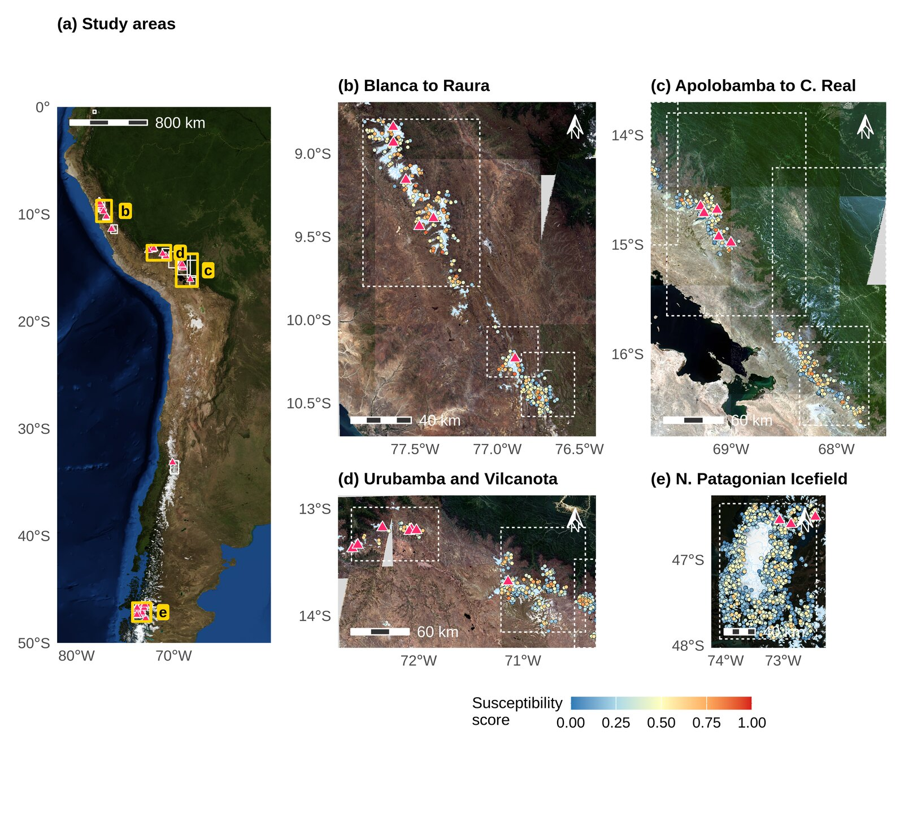
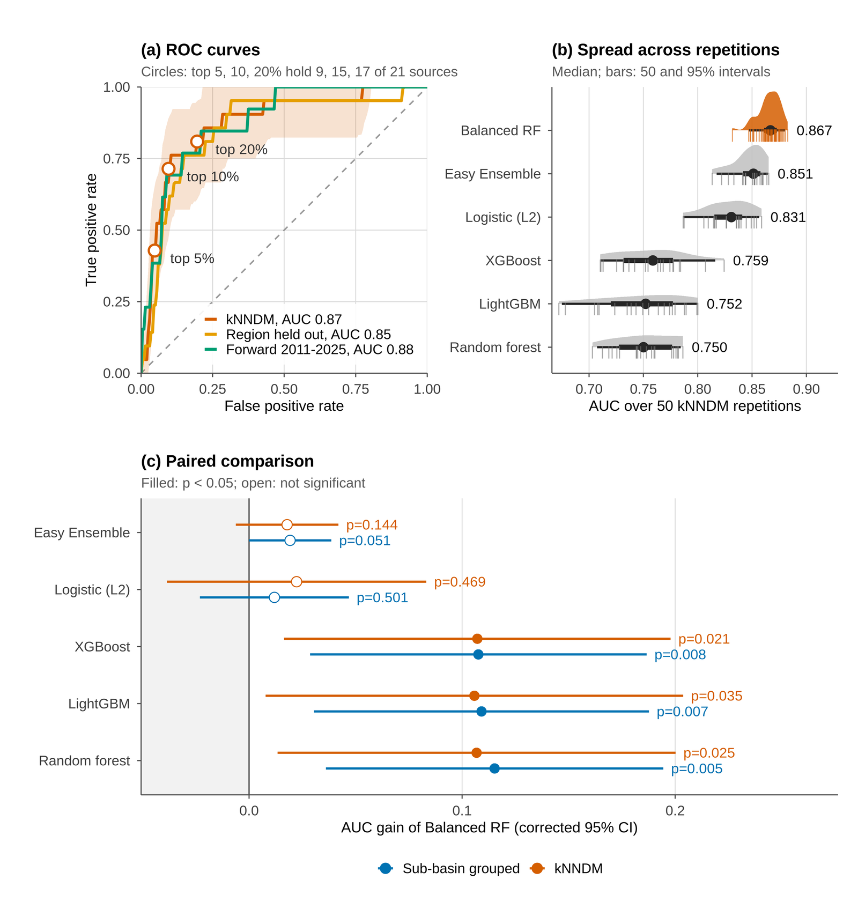
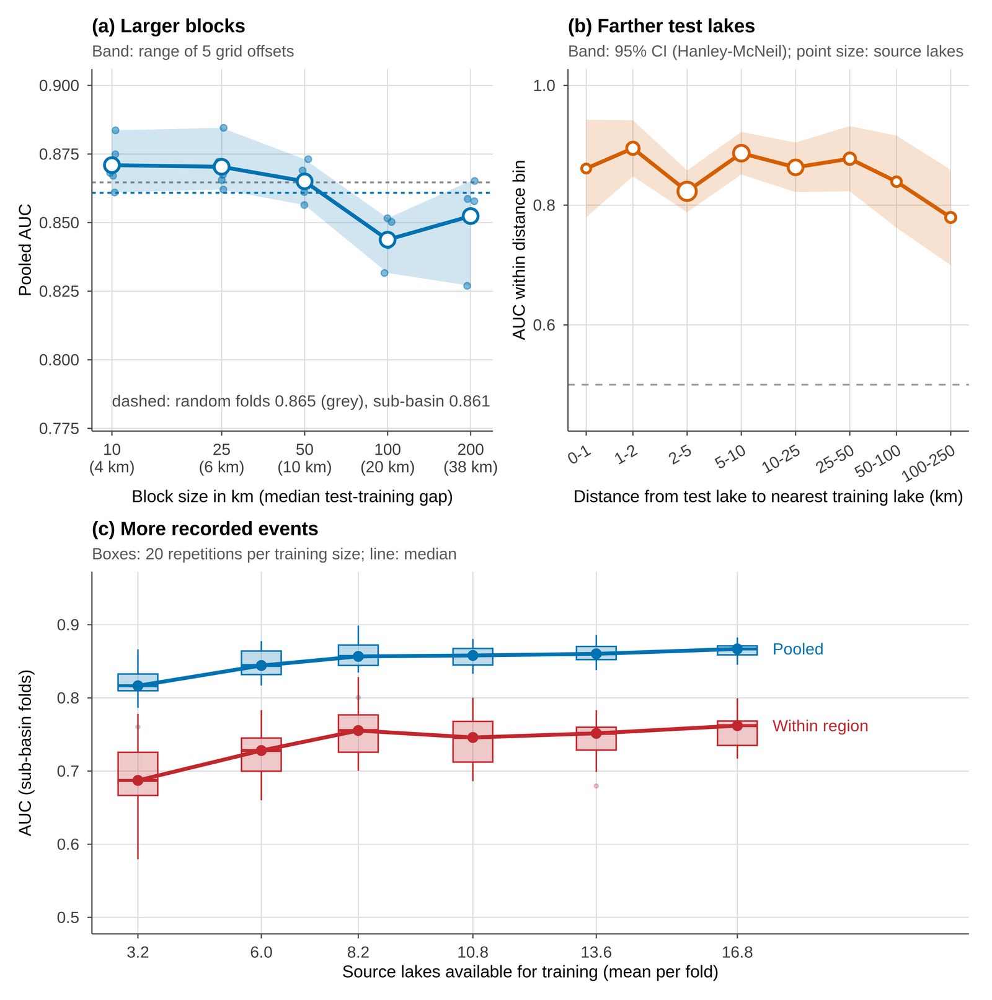
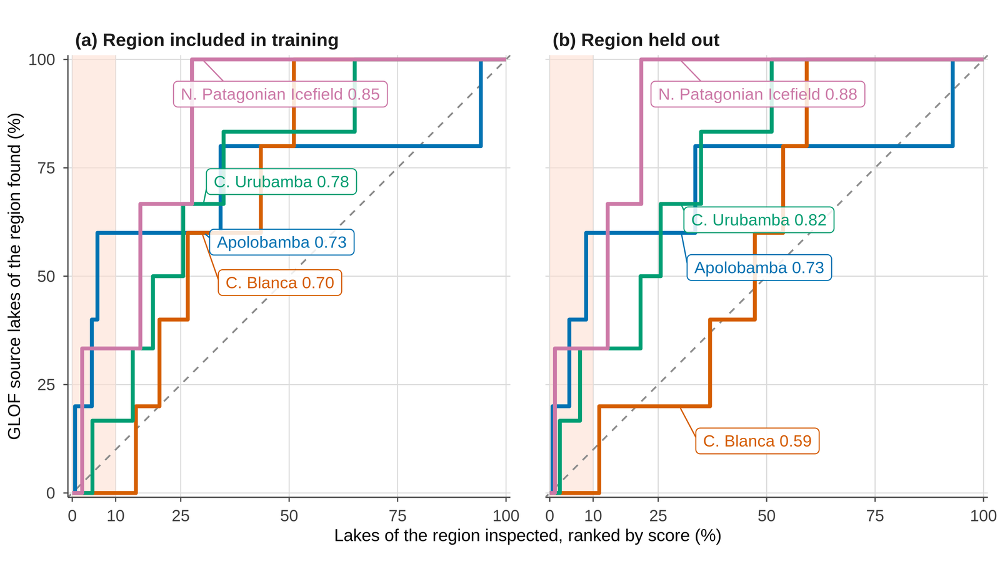

# How far does a GLOF susceptibility model travel? Transfer tests across the Andes

[](#status)
[](LICENSE)
[](https://www.python.org/)
[](https://www.r-project.org/)
[](https://doi.org/10.5281/zenodo.7330344)

Open pipeline that builds an annual glacial lake inventory for 13 Andean areas from
Landsat (1985-2016) and Sentinel-2 (2017-2025) under one set of criteria, and tests
whether glacial lake outburst flood (GLOF) susceptibility learned in some cordilleras
and years holds in others.



## Status

The full pipeline was run on 1-2 November 2026 and produces every number, table and
figure of the manuscript prepared for *Natural Hazards*. Numbers from earlier versions
of this repository should not be cited.

## Questions

1. **Transferability.** How much does discrimination drop when a whole cordillera
   is withheld, compared with cross-validation matched to the prediction task?
2. **Distance decay.** How does performance change with the distance between
   training and test lakes (spatial blocks from 10 to 200 km with random grid
   offsets, Moran's I correlograms of predictors and residuals)?
3. **Within or between regions.** How much of the pooled accuracy comes from ranking
   lakes inside a region, and how much from separating regions?
4. **Forward in time.** Does a model trained on events up to 2010 rank the lakes that
   drained in 2011-2025?

## Results at a glance

| | |
|---|---|
| Modelled lakes / GLOF source lakes | 3,281 / 21 (moraine and bedrock dams, 2002-2025) |
| Pooled AUC, kNNDM cross-validation | 0.87 (95% CI 0.77-0.94) |
| AUC in the tropical Andes | 0.82 (0.70-0.90) |
| Mean AUC inside regions | 0.76 (0.60-0.86) |
| Forward test (trained to 2010, events 2011-2025) | 0.88 |
| Region held out | 0.59-0.88 (mean 0.76) |



Accuracy against block size, distance to the training lakes and number of recorded events:



Share of each region's source lakes found when its lakes are inspected by score, with the
region in training and held out:



## Data

| Source | Use |
|---|---|
| Landsat 4, 5, 7 and 8 Collection 2 Level-2 (1985-2016) | annual dry-season MNDWI, NDWI and NIR mosaics, 30 m, QA_PIXEL masked |
| Sentinel-2 L2A (2017-2025) | annual dry-season MNDWI, NDWI and NIR mosaics, 20 m, SCL masked; SCL water layer for dark lakes |
| NASADEM | elevation and terrain derivatives |
| RGI 7.0 | glacier outlines, glacier-proximity criterion |
| [GLOF database v4.2](https://doi.org/10.5281/zenodo.7330344) (Lützow et al., 2023, *ESSD* 15, 2983-3000) | outburst events, RGI regions 16 and 17 |

Nothing is redistributed here. Imagery comes from Microsoft Planetary Computer; the
`planetary-computer` package signs each request with a free, short-lived token, so no
account is needed. NASA Blue Marble imagery for the overview map is downloaded from
NASA Earth Observatory. The event catalogue is downloaded from Zenodo at a fixed version
by `scripts/00_glof_catalogue.py`.

## Running

```bash
python -m venv .venv && .venv/bin/pip install -r requirements.txt
./run_pipeline.sh               # all study areas, in order
./run_pipeline.sh <area_name>   # one study area
```

| Stage | Scripts |
|---|---|
| Event catalogue and glaciers | `00_glof_catalogue.py`, `00_rgi_glaciers.py`, `00_osm_context.py` (mines, reservoirs, roads, settlements) |
| Acquisition | `01_download_landsat.py`, `02_download_s2.py` |
| Terrain | `03_process_dem.py` |
| Lake detection | `04_detect_lakes.py` (shared criteria in `src/detection.py`) |
| Features | `05_lake_features.py` |
| Physical lakes and labelling | `06_physical_lakes.py`, `07_label_events.py` |
| Lake table, feature sets, collinearity | `08_lake_table.py` |
| kNNDM folds and distance distributions (R, `CAST`) | `09_cv_folds.R` |
| Repeated CV, transfer and forward validation | `10_train_validate.py` |
| Distance decay, correlograms, area of applicability | `11_spatial_diagnostics.py` |
| Calibration and paper statistics | `12_paper_stats.py` |
| Positive-unlabelled analysis (supplementary) | `13_pu_learning.py` |
| Screening and interpretation | `14_inventory_screen.py`, `15_shap.py` |
| Coverage diagnostics | `16_coverage_gaps.py` |
| Learning curve | `17_learning_curve.py` |
| True-colour basemaps for Fig. 1 | `18_basemap_rgb.py` |
| Sensitivity to the cut-off draw of non-source lakes | `19_cutoff_seeds.py` |
| Figures and tables (R) | `20_figures.R`, `21_tables.R`, `22_maps.R` |
| TIFF export for submission | `23_export_submission.py` |

### Reproducing the manuscript

| Manuscript item | File | Script |
|---|---|---|
| Fig. 1 | `Fig01_study_area` | `18_basemap_rgb.py`, `22_maps.R` |
| Fig. 2 | `Fig02_inventory` | `20_figures.R` |
| Fig. 3 | `Fig03_nn_distances` | `09_cv_folds.R`, `20_figures.R` |
| Fig. 4 | `Fig04_model_performance` | `10_train_validate.py`, `20_figures.R` |
| Fig. 5 | `Fig05_distance_learning` | `11_spatial_diagnostics.py`, `17_learning_curve.py`, `20_figures.R` |
| Fig. 6 | `Fig06_transfer_ranks` | `10_train_validate.py`, `20_figures.R` |
| Fig. 7 | `Fig07_applicability` | `11_spatial_diagnostics.py`, `22_maps.R` |
| Fig. 8 | `Fig08_shap` | `15_shap.py`, `20_figures.R` |
| Figs. 9-10 (appendix) | `FigA1_correlogram`, `FigA2_sensitivity` | `11_spatial_diagnostics.py`, `10_train_validate.py`, `20_figures.R` |
| Online Resource 1 | `OR1_map_<area>` | `22_maps.R` |
| Tables 2-10 | `paper/tables/tab_*.tex` | `12_paper_stats.py`, `21_tables.R`, `validation/v5_inventory_compare.py` |

On a 16-core workstation with 30 GB of RAM, the downloads (about 65 GB of mosaics)
took several days over a home connection; steps 03-16 took about 1.5 h, the basemaps
about 40 min and the figures and tables a few minutes. Random seeds are fixed in
every script.

`scripts/validation/` together with `webapp/` supports manual review of detected lakes.

Study areas, bounding boxes and seasons are defined in `config_expanded_study_areas.py`.

## Design choices

- **The same detector for both sensors.** Water is MNDWI > 0, NDWI > 0.1 and NIR < 0.15
  (NIR rejects snow); for Sentinel-2, pixels classified as water by the scene
  classification layer with NIR < 0.05 are also accepted, because the atmospheric
  correction darkens some high-altitude lakes. Polygons steeper than 15 degrees and
  lakes with no valid elevation pixel are dropped. The minimum area is 9000 m², and the
  lake centroid must lie within 5 km of RGI 7.0 ice.
- **Checked elevation tiles.** Cached NASADEM tiles are reused only if they cover the
  current study area.
- **Multi-scene mosaics.** Each annual mosaic uses several dates from the dry season,
  with clouds and shadows masked per pixel.
- **Physical lakes.** Annual detections are merged by DBSCAN within each UTM zone.
- **Distances are computed in a projected CRS.**
- **No temporal leakage.** Each lake is described only by observations made before its
  cutoff year.
- **Sub-basin grouping.** Lakes are grouped by HydroBASINS level 10 sub-basin, so
  chained lakes of one catchment never sit on both sides of a split.
- **kNNDM cross-validation.** Folds are built with `CAST::knndm` so that test-to-training
  nearest-neighbour distances match those from the inventory lakes to the training
  lakes; random and sub-basin folds are reported alongside, with the W statistic.
- **Leave-one-region-out with AOA.** Transfer to an unseen cordillera is measured by
  withholding each region; the dissimilarity index and area of applicability
  (Meyer and Pebesma, 2021) show which held-out lakes are extrapolation.
- **Forward temporal validation.** Features frozen at 2010, events from 2011 to 2025
  as the test labels.
- **Repeated CV.** Partitions are repeated with different seeds; models are compared
  with the Nadeau-Bengio corrected t-test on paired fold differences.
- **DEM-era restriction.** NASADEM dates from 2000, so DEM features are used only with
  events after 2000; earlier events enter a sensitivity cohort without DEM features.
- **One validation path.** Every scheme shares the same imputation and resampling,
  fitted inside each training fold.

## Requirements

Python 3.12 with the exact versions in `requirements.txt`; GDAL, GEOS and PROJ;
R 4.6 with the packages and versions in `requirements_R.txt`.

## Maintainer

[@Andre031222](https://github.com/Andre031222). The data and the code version used in the
manuscript will be archived in Zenodo with a DOI.

## License

Code: MIT. The GLOF database is distributed by its authors under its own terms.
